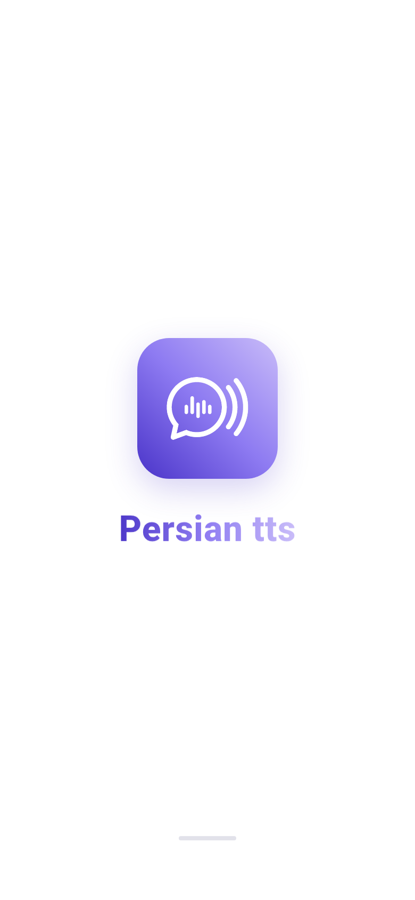
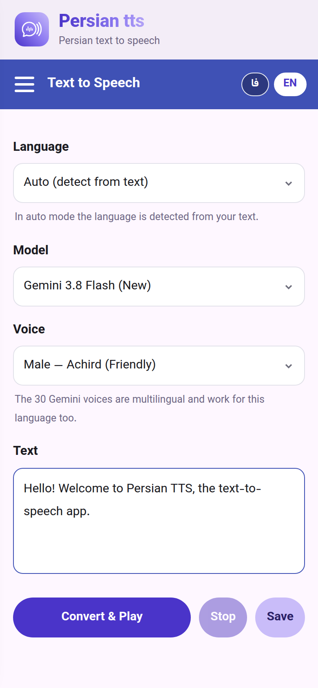
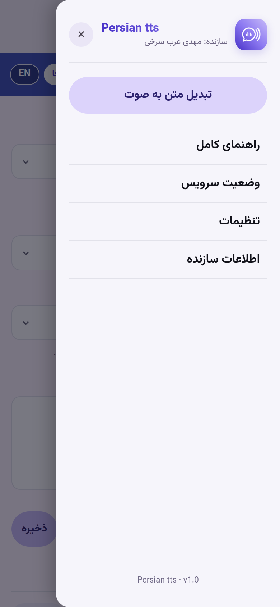
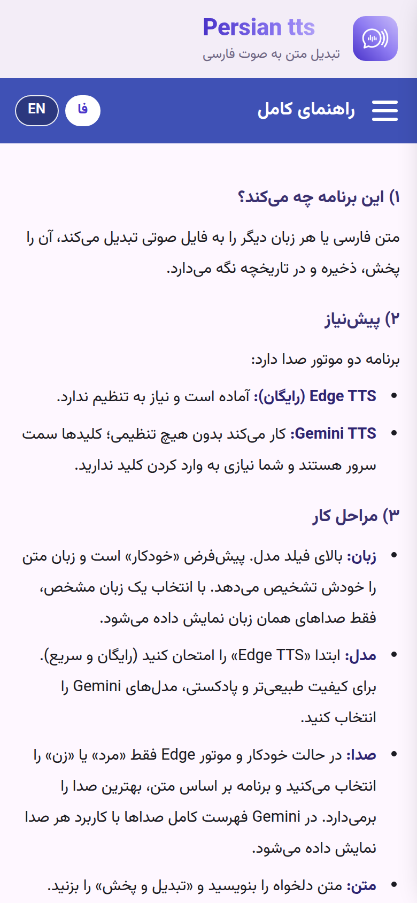
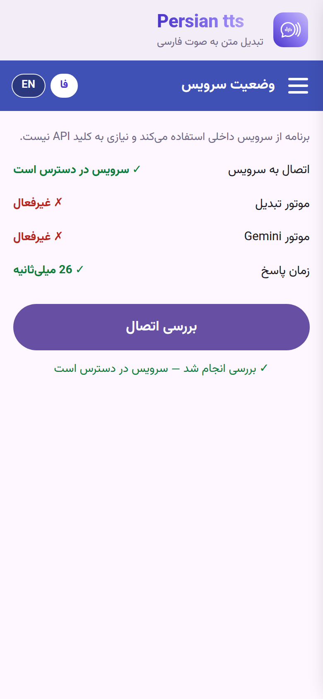
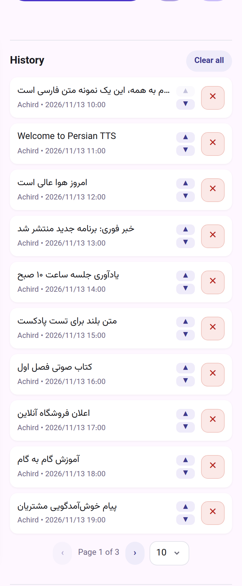

<div dir="rtl">

# Persian TTS — برنامه رایگان تبدیل متن به صوت فارسی برای اندروید

**فارسی** · [English](README.md)

**نسخه ۱.۱:** [دانلود APK امضاشده اندروید](https://github.com/mahdiweb3/persian-tts-android/releases/tag/v1.1). مورد تاریخچه را حدود ۰٫۳۵ ثانیه نگه دارید، بالا یا پایین بکشید و رها کنید تا ترتیب ذخیره شود. کشیدن داخل همان صفحه کار می‌کند؛ دکمه‌های ▲ ▼ بین صفحه‌ها هم جابه‌جا می‌کنند.

**Persian TTS** یک برنامه سبک و سریع اندروید است که متن فارسی (یا هر زبان دیگر) را به صدای طبیعی تبدیل می‌کند. متن را بنویسید یا پیست کنید، صدا را انتخاب کنید، یک دکمه بزنید و فایل MP3 یا WAV تحویل بگیرید؛ پخش، ذخیره و اشتراک‌گذاری‌اش با شماست. برنامه از صداهای Gemini TTS و موتور رایگان Edge TTS استفاده می‌کند، تاریخچه‌ی صفحه‌بندی‌شده از همه‌ی خروجی‌ها نگه می‌دارد و رابط کامل فارسی و انگلیسی دارد.

</div>

<p align="center">
  
  
</p>

<div dir="rtl">

## فهرست

- [امکانات](#امکانات)
- [تصاویر](#تصاویر)
- [شروع سریع در ۳ گام](#شروع-سریع-در-۳-گام)
- [آموزش گام‌به‌گام](#آموزش-گامبهگام)
- [مدل‌ها و صداها](#مدلها-و-صداها)
- [تاریخچه: صفحه‌بندی، تعداد در صفحه و جابجایی](#تاریخچه-صفحهبندی-تعداد-در-صفحه-و-جابجایی)
- [ساخت از روی سورس](#ساخت-از-روی-سورس)
- [قرارداد بک‌اند](#قرارداد-بکاند)
- [ساختار پروژه](#ساختار-پروژه)
- [پرسش‌های متداول](#پرسشهای-متداول)
- [سازنده](#سازنده)

## امکانات

| امکان | توضیح |
| --- | --- |
| تبدیل متن فارسی به صوت | صداهای طبیعی فارسی و تشخیص خودکار زبان برای متن‌های ترکیبی |
| ۵ مدل | چهار مدل Gemini TTS و موتور رایگان Edge TTS |
| ۳۰ صدای Gemini | هر صدا با ویژگی‌اش (آرام، دوستانه، محکم، سبک…) مشخص شده |
| متن بلند | متن به بخش‌های کوچک تقسیم، تبدیل و در یک فایل ادغام می‌شود |
| ذخیره در Downloads | فایل MP3 یا WAV در `Downloads/PersianTTS` |
| تاریخچه‌ی صفحه‌بندی‌شده | بدون سقف، ۱۰ / ۲۰ / ۵۰ / ۱۰۰ مورد در هر صفحه، جابجایی بالا و پایین |
| دو زبان | فارسی (راست‌به‌چپ) و انگلیسی (چپ‌به‌راست) با تغییر آنی |
| سبک | رابط WebView؛ حجم APK حدود ۳۰۰ کیلوبایت |
| بدون کلید API روی گوشی | کلیدهای سرویس‌دهنده فقط روی سرور شما می‌مانند |

## تصاویر

| منو | راهنمای کامل | وضعیت سرویس |
| --- | --- | --- |
|  |  |  |

| تاریخچه (فارسی) | تاریخچه (انگلیسی) |
| --- | --- |
|  |  |

## شروع سریع در ۳ گام

۱. APK را بسازید ([ساخت از روی سورس](#ساخت-از-روی-سورس)) و روی اندروید ۷ یا بالاتر نصب کنید.
۲. برنامه را باز کنید، متنی بنویسید و **تبدیل و پخش** را بزنید.
۳. با **ذخیره** فایل صوتی را در پوشه‌ی Downloads نگه دارید.

> برنامه به یک بک‌اند TTS که خودتان میزبانی می‌کنید وصل می‌شود. آدرس آن را یک بار در `app/src/main/assets/index.html` تنظیم کنید؛ [قرارداد بک‌اند](#قرارداد-بکاند) را ببینید.

## آموزش گام‌به‌گام

### ۱. انتخاب زبان

فیلد **زبان** پیش‌فرض روی «خودکار (تشخیص از متن)» است. اگر زبان مشخصی انتخاب کنید، فقط صداهای همان زبان نمایش داده می‌شود.

### ۲. انتخاب مدل

با **Edge TTS (رایگان)** شروع کنید؛ سریع است و به تنظیم نیاز ندارد. برای صدای طبیعی‌تر و پادکستی یکی از مدل‌های **Gemini** را بردارید. [جدول مدل‌ها](#مدلها-و-صداها) را ببینید.

### ۳. انتخاب صدا

- **Edge TTS در حالت خودکار:** فقط مرد یا زن را انتخاب کنید؛ برنامه بر اساس متن بهترین صدا را برمی‌دارد.
- **Gemini:** فهرست کامل ۳۰ صدا با توضیح کوتاه هر صدا نمایش داده می‌شود.

### ۴. نوشتن متن

متن را تایپ یا پیست کنید. متن بلند مشکلی ندارد؛ به بخش‌های کوچک تقسیم و دوباره در یک فایل ادغام می‌شود و پیشرفت را به‌صورت «بخش ۲ از ۵» می‌بینید.

### ۵. تبدیل و پخش

دکمه‌ی **تبدیل و پخش** را بزنید. دکمه‌ی **توقف** در هر لحظه تبدیل یا پخش را متوقف می‌کند.

### ۶. ذخیره‌ی فایل

دکمه‌ی **ذخیره** فایل را با فرمت MP3 (Edge) یا WAV (Gemini) در `Downloads/PersianTTS` می‌نویسد.

### ۷. استفاده از تاریخچه

هر خروجی به **تاریخچه** اضافه می‌شود. روی آیتم بزنید تا دوباره پخش شود، با ✕ حذفش کنید یا نگه دارید و بالا و پایین بکشید تا جابه‌جا شود. دکمه‌های ▲ ▼ هم همچنان کار می‌کنند. جزئیات در [بخش بعد](#تاریخچه-صفحهبندی-تعداد-در-صفحه-و-جابجایی).

### ۸. تغییر زبان برنامه

با دکمه‌های **فا / EN** کنار عنوان، کل رابط بین فارسی راست‌به‌چپ و انگلیسی چپ‌به‌راست عوض می‌شود؛ اعداد منوی تعداد در صفحه هم همراهش تغییر می‌کنند.

## مدل‌ها و صداها

| مدل | موتور | خروجی | مناسب برای |
| --- | --- | --- | --- |
| Gemini 3.8 Flash (جدید) | Gemini TTS | WAV | بالاترین کیفیت، پیش‌فرض |
| Gemini 3.8 Flash Lite | Gemini TTS | WAV | سریع‌تر و سبک‌تر |
| Gemini 3.1 Flash | Gemini TTS | WAV (از PCM) | جایگزین پایدار |
| Gemini 2.5 Flash | Gemini TTS | WAV (از PCM) | مدل پشتیبان |
| Edge TTS (رایگان) | صداهای Edge مایکروسافت | MP3 | پیش‌نویس سریع و رایگان |

هر ۳۰ صدای Gemini (مثل Achernar، Achird، Algenib، Aoede و بقیه) چندزبانه‌اند و برای فارسی هم کار می‌کنند.

## تاریخچه: صفحه‌بندی، تعداد در صفحه و جابجایی

| بخش | رفتار |
| --- | --- |
| بدون سقف | محدودیت قبلی ۲۰ مورد برداشته شده |
| ‹ صفحه X از Y › | رفتن بین صفحه‌ها؛ در صفحه‌ی اول و آخر دکمه‌ی مربوط غیرفعال می‌شود |
| منوی تعداد در صفحه | ۱۰، ۲۰، ۵۰ یا ۱۰۰؛ در رابط فارسی با ارقام فارسی و در انگلیسی با ارقام لاتین |
| ▲ ▼ کنار هر آیتم | آیتم را یک جایگاه جابجا می‌کند؛ بین صفحه‌ها هم کار می‌کند |
| نگه‌داشتن و کشیدن (۱.۱) | حدود ۰٫۳۵ ثانیه نگه دارید، بالا یا پایین بکشید و رها کنید؛ جابه‌جایی داخل همان صفحه است. کشیدن سریع همچنان اسکرول می‌کند و لمس کوتاه پخش می‌کند |
| ماندگاری | ترتیب و تعداد در صفحه به خاطر سپرده می‌شود |
| ✕ | آیتم و فایل صوتی ذخیره‌شده‌اش را حذف می‌کند |

## ساخت از روی سورس

پیش‌نیاز: JDK 17، اندروید SDK (compileSdk 34) و اینترنت برای Gradle.

</div>

```bash
git clone https://github.com/mahdiweb3/persian-tts-android.git
cd persian-tts-android
echo "sdk.dir=$ANDROID_HOME" > local.properties
./gradlew assembleDebug
# APK: app/build/outputs/apk/debug/app-debug.apk
```

<div dir="rtl">

برای نسخه‌ی release امضاشده، keystore خودتان را بسازید و با متغیر محیطی معرفی کنید:

</div>

```bash
export TTS_KEYSTORE=/path/to/your.jks
export TTS_KSPASS=your-password
export TTS_KEYALIAS=your-alias
./gradlew assembleRelease
```

<div dir="rtl">

## قرارداد بک‌اند

برنامه مستقیم به گوگل یا مایکروسافت وصل نمی‌شود. دو ثابت بالای فایل `app/src/main/assets/index.html` را ویرایش کنید:

</div>

```js
const API_BASE  = 'https://your-backend.example.com';
const API_TOKEN = 'YOUR_APP_TOKEN';
```

<div dir="rtl">

سرور شما باید این دو مسیر را داشته باشد:

| مسیر | درخواست | پاسخ |
| --- | --- | --- |
| `GET /health` | ندارد | JSON به شکل `{"ok": true, "gemini_keys": N, "edge": true}` |
| `POST /v1/audio/speech` | JSON به شکل `{"backend":"gemini","model":"…","voice":"…","text":"…"}` یا `{"backend":"edge","voice":"fa-IR-DilaraNeural","text":"…"}` با هدر `X-App-Token` | بایت‌های خام صدا؛ WAV یا PCM ۱۶ بیتی برای Gemini و MP3 برای Edge |

کلید API سرویس‌دهنده‌ها فقط روی سرور بماند. این مخزن هیچ کلید، توکن یا آدرس سروری ندارد.

## ساختار پروژه

</div>

```text
app/src/main/
├── AndroidManifest.xml
├── java/ir/mahdi/persiantts/MainActivity.java   # WebView host, file saving, preferences bridge
└── assets/
    ├── index.html        # whole UI + logic, Persian and English strings
    ├── voices-data.js    # voice catalogue
    ├── font.css          # embedded Vazirmatn font
    └── logo.png
docs/screenshots/         # images used in this README
```

<div dir="rtl">

## پرسش‌های متداول

**برنامه رایگان است؟** بله، خود برنامه رایگان است. Edge TTS رایگان است و مصرف Gemini به سهمیه‌ی کلیدهای سرور شما بستگی دارد.

**روی کدام نسخه‌ی اندروید کار می‌کند؟** اندروید ۷ (API 24) و بالاتر.

**فایل‌های صوتی کجا ذخیره می‌شوند؟** در `Downloads/PersianTTS` و برای پخش تاریخچه در حافظه‌ی خصوصی خود برنامه.

**بدون اینترنت کار می‌کند؟** خیر؛ تبدیل به بک‌اند نیاز دارد.

**چرا تاریخچه کمتر از انتظارم مورد نشان می‌دهد؟** منوی تعداد در صفحه و شماره‌ی صفحه‌ی زیر فهرست را بررسی کنید.

## سازنده

مهدی عرب سرخی — [mahdiarabsorkhi.ir](https://mahdiarabsorkhi.ir) · mobil121382@gmail.com

*کلیدواژه‌ها: تبدیل متن به صوت فارسی، تبدیل متن به گفتار، برنامه TTS فارسی اندروید، Gemini TTS، Edge TTS.*

</div>
