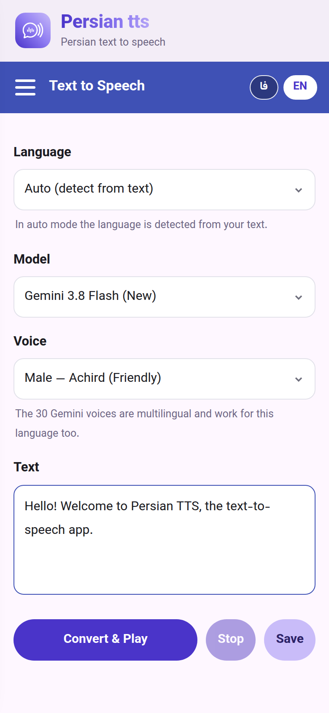
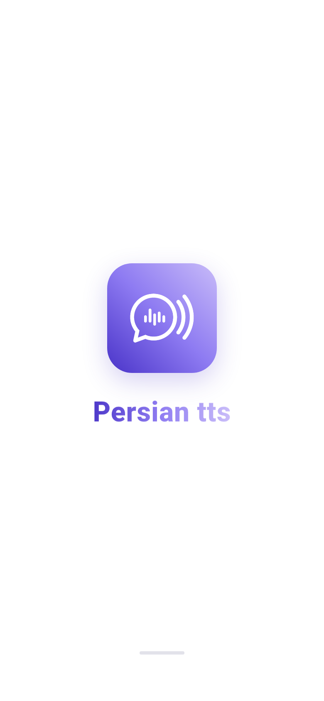
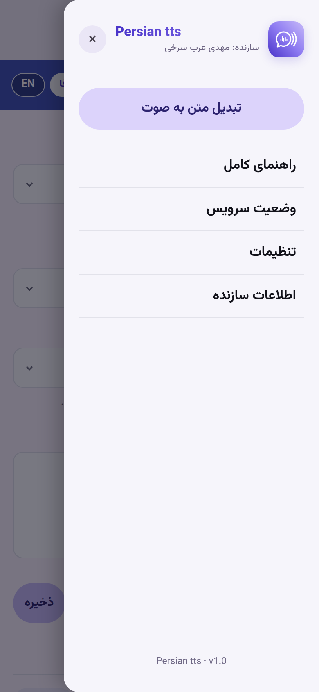
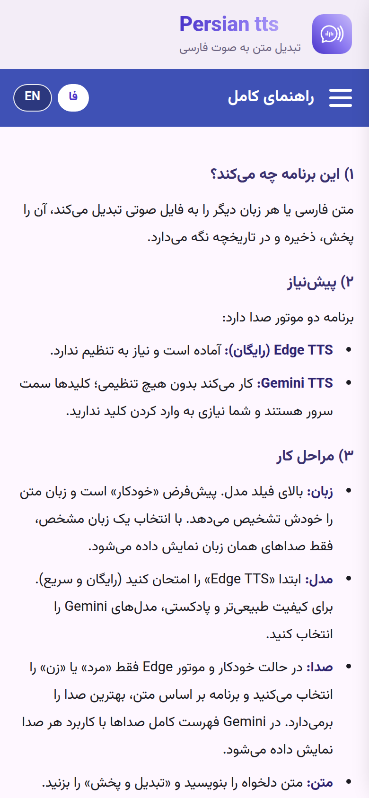
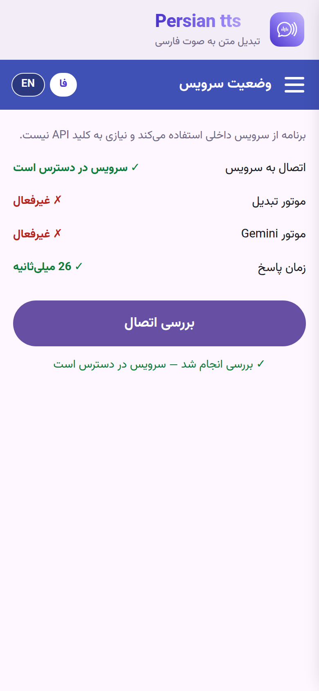
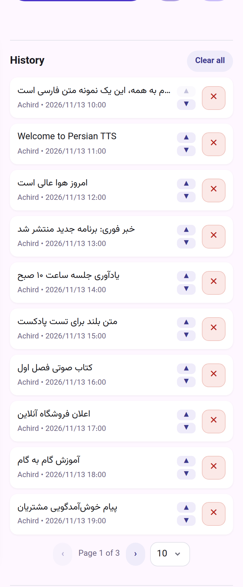

# Persian TTS — Free Persian Text-to-Speech Android App

[فارسی](README.fa.md) · **English**

**Version 1.1:** [Download the signed Android APK](https://github.com/mahdiweb3/persian-tts-android/releases/tag/v1.1). Hold a history item for about 0.35 seconds, drag it up or down, then release to save its position. Dragging works within the current page; ▲ ▼ also move items across pages.

**Persian TTS** is a small, fast Android app that turns Persian (Farsi) text — or any other language — into natural-sounding speech. Type or paste your text, pick a voice, tap one button, and you get an MP3 or WAV file you can play, save and share. It runs on Gemini TTS voices and a free Edge TTS engine, keeps a paginated history of everything you generate, and ships with a full Persian and English interface.

<p align="center">
  
  
</p>

## Contents

- [Features](#features)
- [Screenshots](#screenshots)
- [Quick start (3 steps)](#quick-start-3-steps)
- [Step-by-step guide](#step-by-step-guide)
- [Models and voices](#models-and-voices)
- [History: pages, page size and reordering](#history-pages-page-size-and-reordering)
- [Build from source](#build-from-source)
- [Backend contract](#backend-contract)
- [Project structure](#project-structure)
- [FAQ](#faq)
- [Author](#author)

## Features

| Feature | What you get |
| --- | --- |
| Persian text to speech | Natural Farsi voices, plus automatic language detection for mixed text |
| 5 models | Four Gemini TTS models and the free Edge TTS engine |
| 30 Gemini voices | Every voice is labelled with its character (calm, friendly, firm, breezy…) |
| Long text | Text is split into chunks, converted one by one and merged into a single file |
| Save to Downloads | MP3 or WAV in `Downloads/PersianTTS` |
| Paginated history | Unlimited items, 10 / 20 / 50 / 100 per page, move items up or down |
| Two languages | Persian (right-to-left) and English (left-to-right), switch any time |
| Light on your phone | A WebView front end, the APK is around 300 KB |
| No API key on the device | Provider keys stay on your server |

## Screenshots

| Menu | Full guide | Service status |
| --- | --- | --- |
|  |  |  |

| History (Persian) | History (English) |
| --- | --- |
|  |  |

## Quick start (3 steps)

1. Build the APK (see [Build from source](#build-from-source)) and install it on Android 7.0 or newer.
2. Open the app, type some text and press **Convert & Play**.
3. Press **Save** to keep the audio file in your Downloads folder.

> The app talks to a TTS backend that you host. Set it up once in `app/src/main/assets/index.html`, see [Backend contract](#backend-contract).

## Step-by-step guide

### 1. Choose the language

The **Language** field defaults to *Auto (detect from text)*. Pick a specific language and the voice list shows only voices for it.

### 2. Choose a model

Start with **Edge TTS (Free)**: it is quick and needs nothing else. For more natural, podcast-style speech pick one of the **Gemini** models. See the [model table](#models-and-voices).

### 3. Choose a voice

- **Edge TTS + Auto:** choose Male or Female; the app picks the best voice for your text.
- **Gemini:** the full list of 30 voices appears, each with a short description of its character.

### 4. Write your text

Type or paste in the text box. Long text is fine: it is split into parts and merged back into one file, and you see progress like *part 2 of 5*.

### 5. Convert and play

Press **Convert & Play**. **Stop** cancels a conversion or playback at any moment.

### 6. Save the audio

Press **Save**. The file is written to `Downloads/PersianTTS` as MP3 (Edge) or WAV (Gemini).

### 7. Use the history

Every result is added to **History**. Tap an item to play it again, press ✕ to delete it, or hold and drag it up or down to reorder it. The ▲ ▼ buttons still work. Details in the [next section](#history-pages-page-size-and-reordering).

### 8. Switch the interface language

Use the **فا / EN** buttons beside the title. The whole interface flips between right-to-left Persian and left-to-right English, including the page-size numbers.

## Models and voices

| Model | Engine | Output | Best for |
| --- | --- | --- | --- |
| Gemini 3.8 Flash (New) | Gemini TTS | WAV | Highest quality, default |
| Gemini 3.8 Flash Lite | Gemini TTS | WAV | Faster, lighter |
| Gemini 3.1 Flash | Gemini TTS | WAV (from PCM) | Stable alternative |
| Gemini 2.5 Flash | Gemini TTS | WAV (from PCM) | Fallback model |
| Edge TTS (Free) | Microsoft Edge voices | MP3 | Free, quick drafts |

All 30 Gemini voices (Achernar, Achird, Algenib, Aoede and others) are multilingual and work for Persian.

## History: pages, page size and reordering

| Control | Behaviour |
| --- | --- |
| Unlimited items | The old 20-item cap is gone |
| ‹ Page X of Y › | Move between pages; buttons disable on the first and last page |
| Per-page dropdown | 10, 20, 50 or 100. Numbers use Persian digits in the Persian UI and Latin digits in English |
| ▲ ▼ on each item | Moves the item one place; works across page boundaries |
| Hold and drag (v1.1) | Hold for about 0.35 seconds, drag up or down, then release; reorders within the current page. A quick swipe still scrolls and a short tap still plays |
| Persistence | Order and page size are remembered |
| ✕ | Removes the item and its stored audio file |

## Build from source

Requirements: JDK 17, Android SDK (compileSdk 34), internet access for Gradle.

```bash
git clone https://github.com/mahdiweb3/persian-tts-android.git
cd persian-tts-android
echo "sdk.dir=$ANDROID_HOME" > local.properties
./gradlew assembleDebug
# APK: app/build/outputs/apk/debug/app-debug.apk
```

For a signed release build, create your own keystore and pass it through environment variables:

```bash
export TTS_KEYSTORE=/path/to/your.jks
export TTS_KSPASS=your-password
export TTS_KEYALIAS=your-alias
./gradlew assembleRelease
```

## Backend contract

The app does not call Google or Microsoft directly. Edit these two constants near the top of `app/src/main/assets/index.html`:

```js
const API_BASE  = 'https://your-backend.example.com';
const API_TOKEN = 'YOUR_APP_TOKEN';
```

Your server must provide:

| Method and path | Request | Response |
| --- | --- | --- |
| `GET /health` | none | JSON `{"ok": true, "gemini_keys": N, "edge": true}` |
| `POST /v1/audio/speech` | JSON `{"backend":"gemini","model":"…","voice":"…","text":"…"}` or `{"backend":"edge","voice":"fa-IR-DilaraNeural","text":"…"}`, header `X-App-Token` | Raw audio bytes: WAV or 16-bit PCM for Gemini, MP3 for Edge |

Keep provider API keys on the server only. The repository contains no keys, tokens or server addresses.

## Project structure

```text
app/src/main/
├── AndroidManifest.xml
├── java/ir/mahdi/persiantts/MainActivity.java   # WebView host, file saving, preferences bridge
└── assets/
    ├── index.html        # whole UI + logic, Persian and English strings
    ├── voices-data.js    # voice catalogue
    ├── font.css          # embedded Vazirmatn font
    └── logo.png
docs/screenshots/         # images used in this README
```

## FAQ

**Is Persian TTS free?** The app is free. Edge TTS is free to use; Gemini usage depends on the quota of the keys on your server.

**Which Android versions work?** Android 7.0 (API 24) and newer.

**Where are my audio files?** In `Downloads/PersianTTS`, and inside the app's private storage for history playback.

**Does it work offline?** No. Conversion needs the backend.

**Why does history show fewer items than I expect?** Check the per-page dropdown and the page number under the list.

## Author

Mahdi Arab Sorkhi — [mahdiarabsorkhi.ir](https://mahdiarabsorkhi.ir) · mobil121382@gmail.com

*Keywords: Persian text to speech, Farsi TTS, Android TTS app, Gemini TTS, Edge TTS, تبدیل متن به صوت فارسی.*
